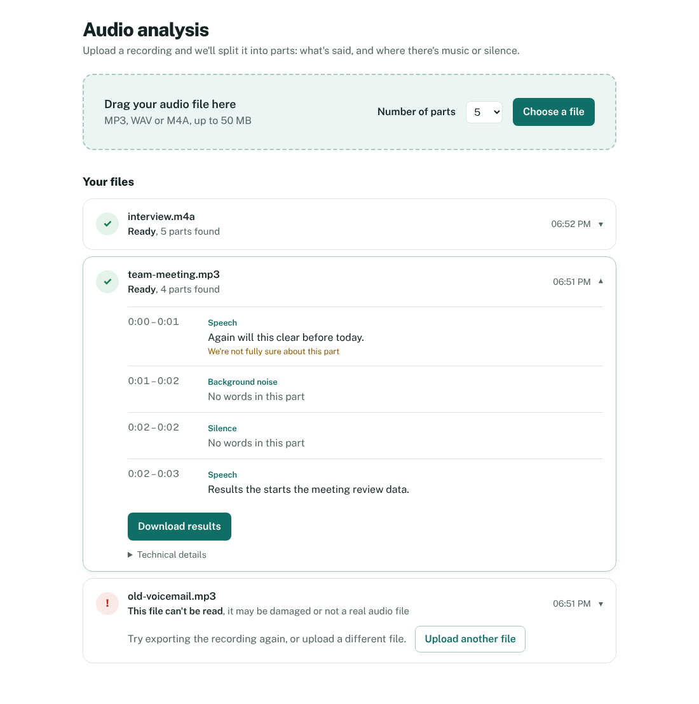
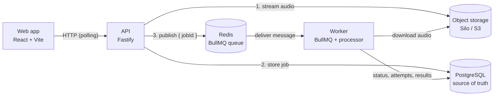
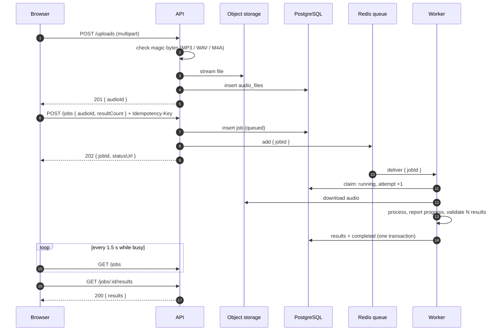
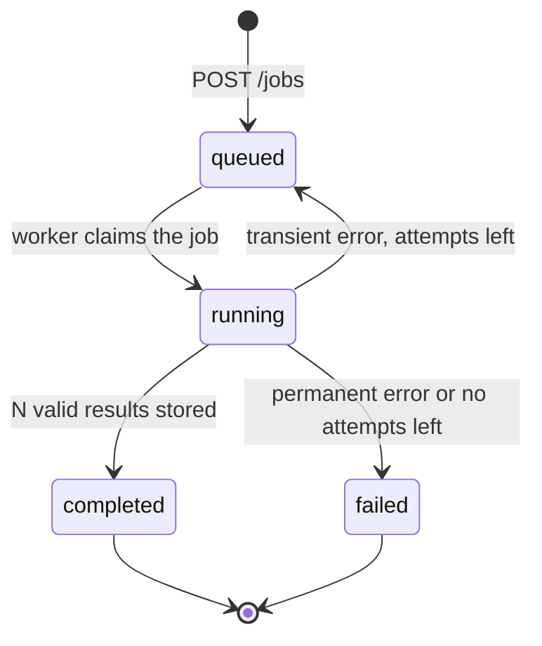

# Async audio processing platform

Upload an audio file, let a separate worker process it in the background, and get back exactly **N** structured results. The browser never waits for the processor: the API stores the job, answers `202 Accepted` with a job ID in a few milliseconds, and the web app follows the job until it is done.

The processor is a **mock**: it reads the real duration of the audio and splits it into N parts, each with a label, text or value, a confidence and timestamps. The assignment is about the infrastructure around the processing, so the focus is on reliability: durable queueing, retries with backoff, idempotency, crash recovery and visibility of failed jobs.



## Contents

- [Quick start](#quick-start)
- [Architecture](#architecture)
- [Reliability](#reliability)
- [API](#api)
- [Configuration](#configuration)
- [Tests](#tests)
- [Observability](#observability)
- [Project structure](#project-structure)
- [Trade-offs](#trade-offs)
- [Limitations and next steps](#limitations-and-next-steps)

## Quick start

**Requirements:** Node.js 22 or newer, pnpm 10 (`npm install -g pnpm@10`) and Docker Desktop.

The commands are for Windows PowerShell; on macOS or Linux use `cp` instead of `Copy-Item`.

```powershell
Copy-Item .env.example .env   # local settings; the defaults work as they are
pnpm install
pnpm stack:up                 # Postgres, Redis and Silo (S3) in Docker
pnpm db:migrate               # create the database schema
```

Then start the three apps, each in its own terminal:

```powershell
pnpm dev:api      # http://localhost:3000
pnpm dev:worker
pnpm dev:web      # http://localhost:5173
```

Open http://localhost:5173 and upload one of the files in `samples/`.

| Service | Address | Login |
|---|---|---|
| Web app | http://localhost:5173 | |
| API | http://localhost:3000 | |
| Health check | http://localhost:3000/health | |
| Metrics | http://localhost:3000/metrics | |
| Storage console (Silo) | http://localhost:9001 | `minioadmin` / `minioadmin` |
| PostgreSQL | `localhost:5432` | `audio` / `audio`, database `audio_jobs` |
| Redis | `localhost:6379` | |

These credentials only exist in the local Docker stack.

## Architecture



| Part | Responsibility |
|---|---|
| **Web app** (`apps/web`) | Upload with progress, status in plain language, results, retry. Polls the API. |
| **API** (`apps/api`) | Validates uploads and requests, stores files and jobs, publishes queue messages, serves status and results. Never processes audio. |
| **Worker** (`apps/worker`) | Takes messages from the queue, runs the processor, validates its output, stores results, decides about retries. Also runs the recovery sweep. |
| **PostgreSQL** | Jobs, attempts, results and audio metadata. The **source of truth** for job state. |
| **Redis + BullMQ** | The durable queue: delivery, backoff timers, crash detection and the list of failed messages. |
| **Silo (S3-compatible)** | The audio files themselves, outside the database. |
| **`packages/shared`** | Queue name, message type, retry settings and job statuses, used by both API and worker. |

### One file, from upload to results



### Job lifecycle



The state lives in PostgreSQL, not in the queue. A queue message only carries the job ID, so the worker always reads the current state. That makes duplicate or late messages harmless: a job that is already `completed` or `failed` is skipped.

### Data model

| Table | Holds | Notable rules |
|---|---|---|
| `audio_files` | Storage key, original name, type, size | Type must be `audio/mpeg`, `audio/wav` or `audio/mp4`; size > 0 |
| `jobs` | Status, N, progress, attempt count, last error, idempotency key, timestamps | `idempotency_key` is unique; a failed job must have an error code; a completed job must be at 100% |
| `job_attempts` | One row per attempt: outcome, error code, safe message, retryable, start and end time | `(job_id, attempt_number)` is unique |
| `results` | Position, label, text or value, confidence, start and end time | `(job_id, position)` is unique, which enforces exactly one result per position; text or value is required; confidence between 0 and 1 |

The rules are database constraints, so even a bug in the code can't store an impossible state. Migrations live in `apps/api/migrations` and run with `pnpm db:migrate`. The runner applies each file once, inside a transaction, refuses files that changed after they were applied, and takes a lock so two processes can't migrate at the same time.

## Reliability

### Retry policy

| | |
|---|---|
| Attempts | 4 in total: the first attempt plus **3 retries** |
| Backoff | Exponential: 2 s, 4 s, 8 s |
| Retried | Errors the processor marks as transient, unknown errors, storage outages, crashed workers |
| Never retried | Invalid or undecodable audio, missing files, invalid processor output, unsupported formats (refused at upload) |
| Recorded per attempt | Attempt number, outcome, error code, safe error message, whether it was retryable, start and end time |

Every processor error carries a `retryable` flag. On a retryable error the worker sets the job back to `queued` with the error and the time of the next try, and throws a normal error so BullMQ schedules the retry. On a permanent error, or when the attempts are used up, it marks the job `failed` and throws BullMQ's `UnrecoverableError`, which stops further retries.

| Error code | Retried | Meaning |
|---|---|---|
| `PROCESSOR_UNAVAILABLE` | yes | The processing service did not respond (simulated by failure injection) |
| `STORAGE_UNAVAILABLE` | yes | The audio could not be downloaded |
| `INTERNAL_ERROR` | yes | Unexpected error; details are logged, never stored or returned |
| `WORKER_LOST` | yes | The worker stopped during this attempt |
| `INVALID_AUDIO` | no | The file can't be decoded |
| `AUDIO_MISSING` | no | The file is no longer in storage |
| `INVALID_PROCESSOR_OUTPUT` | no | The processor returned the wrong number of results or an invalid result |
| `ATTEMPTS_EXHAUSTED` | no | Workers kept crashing on this job |

### Dead letters

A job that fails for good stays visible in two places:

- In PostgreSQL with status `failed`, its error and all attempts: `GET /jobs?status=failed`.
- In BullMQ's failed list (the last 5000 messages), counted in `/metrics` as `audio_queue_messages{state="failed"}`.

In the web app, **Try again** creates a new job for the same uploaded file. The failed job stays in the list as history.

### Idempotency

- **Creating a job:** the client sends an `Idempotency-Key` header. The column has a unique index, and the insert uses `ON CONFLICT DO NOTHING`, so the database decides even when identical requests arrive at the same moment. The same key returns the same job (`Idempotent-Replayed: true`). The same key with a different body returns `409`. The web app creates one key per upload and reuses it when the user clicks "Try again" after a network error.
- **Publishing:** the BullMQ job ID is the database job ID, so the same job can't be in the queue twice.
- **Processing:** the worker only claims a job that is `queued` or `running` and still has attempts left. Results and the `completed` status are written in one transaction, with a unique position per result.

### What happens when…

| Situation | Behaviour |
|---|---|
| The user clicks twice, or retries after a network error | Same Idempotency-Key, so one job |
| The user refreshes or closes the browser | Jobs are stored in PostgreSQL; the open file is kept in the URL |
| Redis is down when a job is created | The job is stored as `queued`; after at most 2 s the API still answers `202`. The worker's recovery sweep publishes it once Redis is back. |
| Redis restarts | Append-only persistence is on, so queued messages survive |
| PostgreSQL restarts | The connection pools recover without crashing the processes |
| A worker crashes mid-job | BullMQ detects the expired lock and redelivers. The worker records the old attempt as `WORKER_LOST` and starts a new one. |
| A job keeps crashing workers | After 4 attempts it is marked `failed` with `ATTEMPTS_EXHAUSTED` |
| A message is delivered twice | The second delivery sees a finished job and is skipped |
| No worker is running | Jobs wait as `queued`; `audio_jobs_oldest_queued_seconds` keeps growing |
| An upload is too large | The stream is cut off at the limit; the partial object is deleted and the API answers `413` |

The **recovery sweep** runs in every worker every 30 seconds. It republishes jobs that have been `queued` for more than 60 seconds without being in the queue (publishing failed), and jobs that have been `running` for more than 5 minutes without progress (the queue gave up on them).

## API

| Method and path | Purpose | Success | Errors |
|---|---|---|---|
| `POST /uploads` | Upload one file as `multipart/form-data`, field `file` | `201` | `400` empty or no file, `413` too large, `415` unsupported format or not multipart |
| `POST /jobs` | Create a job for `audioId` with `resultCount` (1–20, default 5) | `202` | `400` invalid input, `404` unknown audio, `409` Idempotency-Key reused with another body |
| `GET /jobs/:id` | Status, progress, attempts, error and retry info | `200` | `404` |
| `GET /jobs/:id/results` | The N results, ordered by position | `200` | `404`, `409` while not completed |
| `GET /jobs?status=&limit=` | Newest jobs, optionally filtered by status (default limit 20, max 100) | `200` | `400` |
| `GET /jobs/:id/attempts` | Every attempt with its outcome and error | `200` | `404` |
| `GET /health` | Checks PostgreSQL, Redis and storage | `200` | `503` when one of them is down |
| `GET /metrics` | Metrics in the Prometheus text format | `200` | |

Every error has the same shape:

```json
{ "error": { "code": "JOB_NOT_COMPLETED", "message": "The job is running, results are not available", "details": { "status": "running", "statusUrl": "/jobs/…" } } }
```

<details>
<summary>Example responses</summary>

`POST /uploads` → `201`

```json
{ "audioId": "3f8c…", "fileName": "meeting.mp3", "mimeType": "audio/mpeg", "sizeBytes": 12452, "createdAt": "2026-10-19T16:51:02.114Z" }
```

`POST /jobs` with body `{ "audioId": "3f8c…", "resultCount": 3 }` → `202`, header `Location: /jobs/9b64…`

```json
{ "jobId": "9b64…", "status": "queued", "statusUrl": "/jobs/9b64…" }
```

`GET /jobs/9b64…` while a retry is pending → `200`

```json
{
  "jobId": "9b64…",
  "status": "queued",
  "progress": 0,
  "resultCount": 3,
  "attempts": 1,
  "maxAttempts": 4,
  "error": null,
  "retry": {
    "lastError": { "code": "PROCESSOR_UNAVAILABLE", "message": "The processing service did not respond (simulated failure)" },
    "nextRetryAt": "2026-10-19T16:51:05.420Z"
  },
  "audio": { "audioId": "3f8c…", "fileName": "meeting-fail-once.mp3" },
  "statusUrl": "/jobs/9b64…",
  "resultsUrl": null,
  "createdAt": "…", "updatedAt": "…", "startedAt": "…", "finishedAt": null
}
```

`GET /jobs/9b64…/results` → `200`

```json
{
  "jobId": "9b64…",
  "resultCount": 3,
  "results": [
    { "position": 1, "label": "speech", "text": "The team will review the results today.", "value": null, "confidence": 0.93, "startMs": 0, "endMs": 1044 },
    { "position": 2, "label": "music", "text": null, "value": -12.4, "confidence": 0.81, "startMs": 1044, "endMs": 2088 },
    { "position": 3, "label": "silence", "text": null, "value": -51.7, "confidence": 0.77, "startMs": 2088, "endMs": 3133 }
  ]
}
```

For non-speech parts, `value` is the loudness in dBFS.

</details>

### How the upload is validated

The file type is detected from the first bytes of the content ("magic bytes"), not from the file name or the `Content-Type`, because the client chooses both. The file is streamed straight to object storage; it is never held in memory as a whole.

## Configuration

All settings live in `.env`. `.env.example` lists every one with a working local default. The API and the worker validate them at start-up and stop with a clear message when something is missing or invalid.

| Variable | Default | Meaning |
|---|---|---|
| `API_PORT` | `3000` | Port of the API |
| `DATABASE_URL`, `REDIS_URL` | local Docker | Connections |
| `S3_ENDPOINT`, `S3_REGION`, `S3_BUCKET`, `S3_ACCESS_KEY`, `S3_SECRET_KEY` | local Docker | Object storage |
| `MAX_UPLOAD_MB` | `50` | Upload size limit |
| `DEFAULT_RESULT_COUNT`, `MAX_RESULT_COUNT` | `5`, `20` | N when none is given, and the highest allowed N |
| `WORKER_CONCURRENCY` | `2` | Jobs one worker processes at the same time |
| `MOCK_PROCESSING_MS` | `4000` | How long the mock pretends to work |
| `FAILURE_INJECTION` | `true` | File names containing `fail-once`, `fail-twice` or `fail-always` fail on purpose. Turn this off outside demos. |
| `MOCK_FAILURE_RATE` | `0` | Extra random failure chance, from 0 to 1 |
| `RECOVERY_INTERVAL_SECONDS` | `30` | How often the recovery sweep runs |
| `STALE_QUEUED_SECONDS`, `STALE_RUNNING_SECONDS` | `60`, `300` | When the sweep considers a job stuck |
| `QUEUE_PREFIX` | `bull` | Prefix of the queue keys in Redis |
| `LOG_LEVEL` | `info` | `debug` also logs every successful read request |

The web app repeats the upload limit and the result counts in `apps/web/src/lib/limits.ts` for instant feedback. The API checks them again.

## Tests

```powershell
pnpm stack:up     # the tests use the real services
pnpm typecheck    # all apps and the tests
pnpm test         # 47 tests, about 10 seconds
```

These are integration tests against real PostgreSQL, Redis and object storage, because the hard parts (transactions, unique constraints, queue delivery, backoff) only show up there. The tests use their own database (`audio_jobs_test`), bucket (`audio-uploads-test`) and queue prefix (`test`). They are created automatically, and the development data is never touched, so the tests can run while the dev processes are running.

| File | Covers |
|---|---|
| `apps/api/test/uploads.test.ts` | Accepted formats, detection by content, unsupported and fake files, empty files, the size limit (nothing is stored), non-multipart requests |
| `apps/api/test/jobs.test.ts` | 202 and queue message, default N, idempotency (including 10 concurrent identical requests), validation, 404 and 409 cases, result ordering, the dead-letter filter |
| `apps/api/test/observability.test.ts` | Request IDs, the request ID in the queue message, metrics values |
| `apps/worker/test/process-job.test.ts` | Exactly N results, duplicate messages, retry and success, last attempt, no retry for invalid or missing audio or invalid output, no leaked error details, `WORKER_LOST`, `ATTEMPTS_EXHAUSTED` |
| `apps/worker/test/end-to-end.test.ts` | The whole chain over HTTP and the real queue: N results, a retry that waits at least the backoff and then succeeds, a broken file that fails after one attempt |

To check that the tests catch real bugs, the retry logic, the size-limit check and the request-ID forwarding were each broken on purpose. Each time, the matching tests failed.

## Observability

**Logs** are JSON lines, one per event:

- **API:** one line per request, with method, URL, status and duration. Plus `audio uploaded` (without the file name, which can contain personal data) and `job created`.
- **Worker:** `job started`, `job attempt failed, will retry`, `job completed` or `job failed`, each with the duration.

Every worker line carries `jobId` and `attempt`, so searching for a job ID shows its whole history.

**Request IDs:** every response has an `X-Request-Id` header. A safe ID sent by the client is reused, otherwise a new one is generated. The ID travels with the queue message, so the worker's log lines for a job carry the `requestId` of the HTTP request that created it.

**Metrics:** `GET /metrics`, in the Prometheus text format, computed from the database and the queue on each request.

| Metric | Use |
|---|---|
| `audio_jobs{status}` | Jobs per status |
| `audio_jobs_oldest_queued_seconds` | Keeps growing when no worker is running; the main alert signal |
| `audio_job_attempts_total{outcome}` | Finished attempts, succeeded and failed |
| `audio_job_attempt_failures_total{code}` | Failed attempts per error code |
| `audio_job_attempt_duration_seconds{quantile}` | Median and 95th percentile of successful attempts in the last hour |
| `audio_queue_up`, `audio_queue_messages{state}` | Whether Redis is reachable, and the queue per state (`failed` is the dead-letter list) |

## Project structure

```
apps/
  api/          Fastify API
    migrations/   SQL schema, applied in order
    src/          routes (uploads/, jobs/), config, clients, queue, health, metrics
    test/         API tests and shared test helpers
  worker/       BullMQ worker
    src/          process-job.ts (claim, process, retry decision), recovery.ts, processor/
    test/         worker and end-to-end tests
  web/          React app (Vite, Tailwind)
    src/          api/, hooks/ (polling, upload, results), components/, lib/ (plain-language texts)
packages/
  shared/       queue name, message type, retry settings, job statuses
samples/        test audio, including broken, fake and failure-injection files
scripts/        demo.ps1 (PowerShell demo helpers)
docs/           UITLEG.md (Dutch walkthrough), screenshot
```

The processor is behind one interface (`apps/worker/src/processor/types.ts`). A real speech-to-text processor is a new class that implements `process()`. The queue, retries, storage, API and web app don't change.

## Trade-offs

| Decision | Why | Cost or alternative |
|---|---|---|
| **TypeScript everywhere** | One language; API and worker share types and constants | Python has stronger audio and ML libraries for a real processor |
| **BullMQ on Redis** as the queue | Retries, exponential backoff, delayed jobs and crash detection out of the box; Redis persists with append-only files | One more service. A queue in PostgreSQL (`SKIP LOCKED`, e.g. pg-boss) would remove Redis. |
| **The message carries only the job ID** | PostgreSQL stays the single source of truth; stale or duplicate messages are harmless | One extra query per job |
| **Store first, then publish, plus a recovery sweep** | Simple, and a stored job is never lost | If publishing fails, the job can wait up to about 90 s. The **outbox pattern** (publish from a table written in the same transaction) recovers faster but needs more code. |
| **No jitter in the backoff** | Predictable delays that are easy to test and demonstrate | After a large outage, all retries fire at the same moments. Production would add random jitter. |
| **Idempotency-Key is optional** | Clients without a key still work | Without a key there is no protection against duplicate jobs. The web app always sends one. |
| **Silo instead of MinIO** | MinIO removed its official images from Docker Hub in 2026; Silo is a community fork with the same commands and ports | Smaller community. Production would use a managed S3-compatible service. |
| **The worker loads the whole file into memory** | The metadata library needs a buffer; files are at most 50 MB | Memory use is up to 50 MB × concurrency. Larger files would need streaming or a temporary file. |
| **Polling** instead of push | Simple, works through any proxy, survives API restarts without reconnect logic | Up to 1.5 s delay and more requests than WebSockets or server-sent events. Polling pauses while the tab is hidden. |
| **No authentication** | Out of scope for the assignment | **Everyone sees every job.** Production needs users, and jobs that belong to a user. |
| **Metrics computed from the database** | Correct with several API and worker processes and after restarts | `count(*)` queries per scrape; at millions of rows, in-memory counters (e.g. `prom-client`) or data retention would be needed |
| **Results download as `.txt`** | Opens correctly everywhere | CSV opens differently in Excel per region (comma or semicolon) |
| **Limits repeated in the web app** | Instant feedback before uploading | They can drift from `.env`. A `GET /config` endpoint would fix that. |
| **MP4 video with an audio track is accepted as M4A** | It has the same container signature | The worker only reads the audio |
| **Own migration runner** | About 70 lines, easy to explain, with checksums and a lock | No down-migrations |
| **Credentials in `docker-compose.yml` and `.env.example`** | The stack works right after cloning | **Local only.** Real secrets belong in a secret manager, never in git. |

## Limitations and next steps

- **A real processor:** for example local Whisper (whisper.cpp or faster-whisper) as an extra service in Docker, behind the existing processor interface. Its segments would be mapped onto N equal time windows, using word timestamps.
- Authentication, with jobs owned by users.
- The outbox pattern, and jitter in the backoff.
- Retention: delete old files and jobs automatically.
- Production builds and Docker images for the API, worker and web app. Only the development mode (`tsx`, Vite dev server) has been used and tested.
- Push updates (server-sent events) instead of polling.
